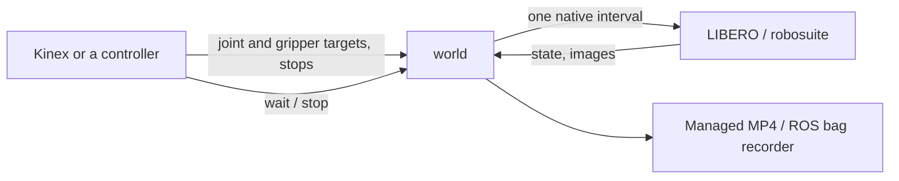

# LIBERO

LIBERO runs in its own Python 3.12 / ROS Jazzy environment with the official Panda
robot, task definitions, initial states, physics and reward functions. The 130 tasks
span `libero_spatial`, `libero_object`, `libero_goal`, `libero_10` and `libero_90`.
Task numbers are one-based, in official task order zero:

```bash
rosbridge prepare libero
rosbridge tasks list --simulator libero
rosbridge launch libero/libero-spatial-01 --execution-mode stepped --record ../ros_libero/run
```

`libero` selects `libero/libero-spatial-01`. Preparation is noninteractive and
prepares all 130 tasks; `prepare libero --task libero-spatial-01` narrows it.
Launch never downloads assets. Upstream LIBERO is pinned to
`8f1084e3132a39270c3a13ebe37270a43ece2a01`, with a managed namespace-packaging
patch. The isolated environment pins robosuite 1.4.0, MuJoCo 3.2.3, NumPy 1.26.4
and CPU PyTorch 2.5.1.

## Graph

Every interface runs on the single `world` node; names match the Kinex devices of
the [robot catalog](kinex.md).

| Device | Interfaces |
| --- | --- |
| `world` | `/clock`, `world/wait`, `world/stop`, `world/spectator/*` while recording |
| `arm` | `arm/joint_state`, `arm/joint_target`, `arm/stop` |
| `gripper` | `gripper/joint_state`, `gripper/target`, `gripper/stop` |
| `camera_agentview` | `camera_agentview/{image,camera_info}` |
| `camera_wrist` | `camera_wrist/{image,camera_info}` (native `robot0_eye_in_hand`) |

Managed runs lease separate ROS domains; use `rosbridge exec RUN_ID -- ...` to join
a run's environment and domain.



## Arm and gripper

`arm/joint_target` takes a `trajectory_msgs/msg/JointTrajectory` naming
`robot0_joint1` through `robot0_joint7` once each, with position-only points in
radians and strictly increasing `time_from_start` ending within 120 seconds. A
zero header stamp starts now; a nonzero stamp must not lie in the past. A valid
trajectory replaces the active one; invalid ones are logged and ignored, so
verify `arm/joint_state`. Targets outside the native joint limits are rejected.

`gripper/target` (`std_msgs/msg/Float64`) is a `finger_joint1` position from 0
(closed) to 0.04 m (open), half of LIBERO's summed finger travel. Every control
interval the backend steers LIBERO's integrated direction command toward it with
1 mm tolerance, so open and closed are reached reliably while intermediate targets
oscillate by a few millimetres. `gripper/joint_state` reports `finger_joint1`.

Each `stop` (`std_srvs/srv/Trigger`) holds the measured position. Commands to a
finished episode are rejected.

## Episode timing

Each action interval advances 0.05 simulation seconds (25 MuJoCo substeps).
Stepped mode advances only through `world/wait`; realtime mode advances on its
own and a wait observes elapsed time. See the shared [wait semantics](README.md).

The episode starts from an official initial state. `randomize: true` chooses a state
with a seeded NumPy generator; `false` selects state zero. Five native
initialization intervals hold the initial arm pose and finger position before the
episode's public clock and step counter start at zero. Native reward and success are
available through `rosbridge judge RUN_ID`; `--stop-on-success` ends the episode on
success.

## Cameras, recording and demo

Observation cameras are 256×256 RGB in frames `camera_agentview/base` and
`camera_wrist/base`, with principal point `(width-1)/2, (height-1)/2`. Images are
rendered at 30 Hz of simulation time only while subscribed, and at once for a new
subscriber, also while the world is paused; reading never advances time. Kinex owns
the calibrated camera frames and TF.

With `--record`, spectator views render the native `agentview` and
`robot0_eye_in_hand` cameras at 960×720 and 10 Hz into `third_person.mp4` and
`wrist.mp4`; `--record-type bag` or `both` adds a ROS bag. Without `--record`
no spectator is rendered. Stop a detached run with `rosbridge stop RUN_ID` to
finalize files. Recording never advances a paused world.

```bash
rosbridge demo libero --record ../ros_libero/demo
rosbridge demo libero --execution-mode realtime
```

The finite ROS-only demo moves the arm out and back, closes and opens the gripper,
and checks both observation cameras. It reports measurements as JSON and shuts
down the graph. It is a control test, not a task-solving policy.

Installed source lives in `.runtime/libero`, model assets in
`.runtime/assets/libero`, and the ROS workspace in `.workspaces/libero`.
Robosuite's shared `/tmp/robosuite.log` is disabled by preparation, so native
logs follow the managed run's stdout/stderr.
