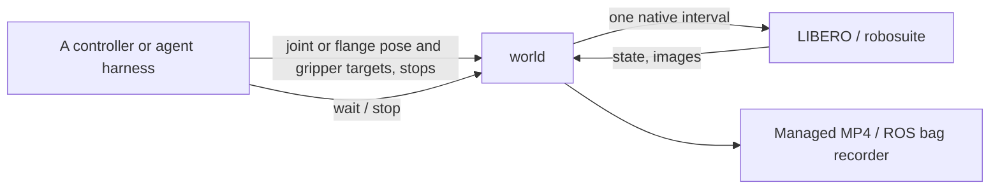

# LIBERO

LIBERO runs in its own Python 3.12 / ROS Jazzy environment with the official Panda
robot, task definitions, initial states, physics and reward functions. The 130 tasks
span `libero_spatial`, `libero_object`, `libero_goal`, `libero_10` and `libero_90`.
Task numbers are one-based, in official task order zero:

```bash
rosbridge prepare libero
rosbridge tasks list --simulator libero
rosbridge launch libero/libero-spatial-01 --execution-mode stepped --record ../ros_libero/run
```

`libero` selects `libero/libero-spatial-01`. Preparation is noninteractive and
prepares all 130 tasks; `prepare libero --task libero-spatial-01` narrows it.
Launch never downloads assets. Upstream LIBERO is pinned to
`8f1084e3132a39270c3a13ebe37270a43ece2a01`, with a managed namespace-packaging
patch. The isolated environment pins robosuite 1.4.0, MuJoCo 3.2.3, NumPy 1.26.4
and CPU PyTorch 2.5.1.

## Graph

Every interface runs on the single `world` node; names match the devices of
the [robot catalog](devices.md).

| Device | Interfaces |
| --- | --- |
| `world` | `/clock`, `world/wait`, `world/stop`, `world/spectator/*` while recording |
| `arm` | `arm/joint_state`, `arm/joint_target`, `arm/stop`; with `--config osc`, `arm/pose_target` and `arm/pose_state` instead of `arm/joint_target` |
| `gripper` | `gripper/joint_state`, `gripper/target`, `gripper/stop` |
| `camera_agentview` | `camera_agentview/{image,camera_info}` |
| `camera_wrist` | `camera_wrist/{image,camera_info}` (native `robot0_eye_in_hand`) |

Managed runs lease separate ROS domains; use `rosbridge exec RUN_ID -- ...` to join
a run's environment and domain.



## Arm and gripper

`arm/joint_target` takes a `trajectory_msgs/msg/JointTrajectory` naming
`robot0_joint1` through `robot0_joint7` once each, with position-only points in
radians and strictly increasing `time_from_start` ending within 120 seconds. A
zero header stamp starts now; a nonzero stamp must not lie in the past. A valid
trajectory replaces the active one; invalid ones are logged and ignored, so
verify `arm/joint_state`. Targets outside the native joint limits are rejected.

`gripper/target` (`std_msgs/msg/Float64`) is a `finger_joint1` position from 0
(closed) to 0.04 m (open), half of LIBERO's summed finger travel. Every control
interval the backend steers LIBERO's integrated direction command toward it with
1 mm tolerance, so open and closed are reached reliably while intermediate targets
oscillate by a few millimetres. `gripper/joint_state` reports `finger_joint1`.

Each `stop` (`std_srvs/srv/Trigger`) holds the measured position. Commands to a
finished episode are rejected.

## OSC configuration

Upstream LIBERO drives the arm with robosuite's `OSC_POSE` controller, and its policies
emit per-step end-effector deltas. `--config osc` runs that controller with upstream's
configuration unchanged, and the arm takes flange pose targets instead of joint targets:

```bash
rosbridge setup libero/libero-spatial-01 --config osc --directory ../my-libero-osc
rosbridge launch libero/libero-spatial-01 --config osc --execution-mode stepped
```

`arm/pose_target` takes a `trajectory_msgs/msg/MultiDOFJointTrajectory` of absolute
`flange` poses in `arm/base` (robosuite's `robot0_right_hand` in `robot0_base`), timed
like joint trajectories and interpolated linearly and by slerp at each 0.05 s step.
`arm/pose_state` reports the measured flange. OSC tracks the gripper's grip site
(`gripper0_grip_site`, the profile's `gripper/tcp`), so each step the backend converts
the flange target to that site and sends upstream's OSC_POSE the delta that reaches it,
from where the site is now. Upstream's clip still limits each step to 5 cm and
0.5 rad per axis, and a target the arm cannot reach is approached, not refused.

A policy trained on upstream's deltas maps onto this closed loop, as robosuite defines
it. Each step's target is the grip site measured with the observation, moved by the
scaled delta and mapped to the flange, timed at one 0.05 s step:

- the position is `p + 0.05 · d[:3]`;
- the rotation is `R(0.5 · d[3:6]) · R`, applied in the world frame.

Accumulating deltas on the previous target instead is a different controller, which
runs ahead when the arm lags. Sent this way, targets reproduce upstream's rollout: the
native suite compares both with an independent upstream OSC environment, to 1e-9.

The episode starts as upstream's evaluation does: five idle OSC actions after the
initial state. Until the arm's first command it idles as upstream's does: the grip
site stays put, and the hand turns onto the orientation goal robosuite's controller
took before the initial state loaded, about a degree. A stop holds the measured flange
pose. The gripper device is the same in both configurations.

## Episode timing

Each action interval advances 0.05 simulation seconds (25 MuJoCo substeps).
Stepped mode advances only through `world/wait`; realtime mode advances on its
own and a wait observes elapsed time. See the shared [wait semantics](README.md).

The episode starts from an official initial state: seed k loads the task's initial state k
(modulo its 50), the one upstream's evaluation gives its episode k
(`libero/lifelong/metric.py`). Five native initialization intervals hold the initial arm
pose and finger position before the episode's public clock and step counter start at
zero; under `--config osc` they are upstream's five idle OSC actions.

Episodes are scored as upstream's evaluation scores them:

- **Step limit:** an episode ends after upstream's evaluation horizon of 600 steps
  (`libero/configs/eval/default.yaml`); the world node's `max_steps` parameter overrides it.
- **Success:** each step's success is `env.step`'s own `done`, the BDDL goal on the
  kinematics the step leaves, as upstream reads it; reward is the same sparse value.
- **Judging:** `rosbridge judge RUN_ID` reports them. `--early-stop` ends the episode at
  the first success, as the evaluator's `done` does. LIBERO has no failure termination.

## Cameras, recording and demo

Observation cameras are 256×256 RGB in frames `camera_agentview/base` and
`camera_wrist/base`, with principal point `(width-1)/2, (height-1)/2`. Images are
rendered at 30 Hz of simulation time only while subscribed, and at once for a new
subscriber, also while the world is paused; reading never advances time. The
calibrated camera frames are in the profiles; the graph publishes no TF.

With `--record`, spectator views render the native `agentview` and
`robot0_eye_in_hand` cameras at 960×720 and 10 Hz into `third_person.mp4` and
`wrist.mp4`; `--record-type bag` or `both` adds a ROS bag. Without `--record`
no spectator is rendered. Stop a detached run with `rosbridge stop RUN_ID` to
finalize files. Recording never advances a paused world.

```bash
rosbridge demo libero --record ../ros_libero/demo
rosbridge demo libero --execution-mode realtime
```

The finite ROS-only demo moves the arm out and back (with `--config osc`, it lifts the
flange 3 cm by pose and back), closes and opens the gripper,
and checks both observation cameras. It reports measurements as JSON and shuts
down the graph. It is a control test, not a task-solving policy.

Installed source lives in `.runtime/libero`, model assets in
`.runtime/assets/libero`, and the ROS workspace in `.workspaces/libero`.
Robosuite's shared `/tmp/robosuite.log` is disabled by preparation, so native
logs follow the managed run's stdout/stderr.
